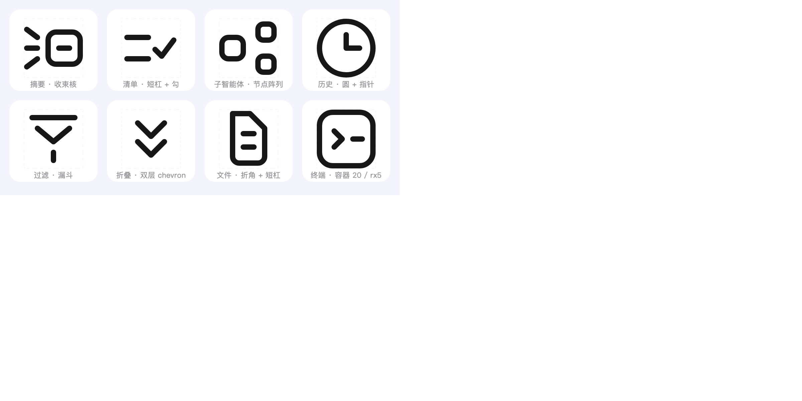

# 断点线性图标风格 · Breakpoint Stroke Icon Style

一套 24px 线性图标的**设计与验收标准**，以及一个**像素级自动验收脚本**。

签名是「**该连的地方故意不连**」，骨架是「**建筑式构成**」。所有 token 不是拍脑袋定的，是从真实产品侧边栏截图**逐像素反测**出来的（含亚像素墨量法测线宽、最小二乘拟合圆角）。



---

## 风格关键词

> 元素不粘连 · 间隙统一 · 线宽恒定 · 构成感 · 建筑感 · 复杂性 · 克制的象形 · 符号化

这八条不是形容，是验收基准——每一条在 `SKILL.md` 里都有对应的可测判据。

## 三种用法

**1. 当 AI 编程助手的 Skill 用（推荐）**

```bash
# WorkBuddy
cp -r . ~/.workbuddy/skills/icon-breakpoint-stroke-style

# Claude Code
cp -r . ~/.claude/skills/icon-breakpoint-stroke-style
```

之后直接说「照这套图标风格给我画一个『摘要』icon」，助手会按 `SKILL.md` 的工作流走完反测 → 拆语义 → 符号化 → 落栅格 → 验收。

**2. 当人读的规范用**

打开 `assets/token-spec.html`——13 章完整规范页：竞品调研、token 表、断点图解、语义→图形映射表、绘制 SOP、16 条验收清单、降级矩阵、反例、构成法则、交付规范。

**3. 只抄参数**

见下面这张表就够了。

## 核心 Token（@24px）

| Token | 值 |
|---|---|
| `grid.size` | 24×24；容器 path 20×20 @(2,2)，圆 r10 |
| `stroke.width` | **2**，全组统一（含内部短杠与斜线） |
| `cap / join` | round / round |
| `container.rx` | **5**（≈25% 边长） |
| `gap.scale` | **{2, 3, 4, 6}** = 1×/1.5×/2×/3× 线宽 |
| `gap.break` | 2–3（该断的地方断多宽） |
| `dash.inner` | 长 3–6，厚度 **2**（与主线等粗） |
| `overshoot` | ±1–2（只动位置，不动粗细） |
| `color` | 默认 `#96969B`，激活 `#171718` |

验收口诀：

> 线 2 圆头；框圆角五分一；杠短四到六；见细就断开，断口一倍半；间隙只用二三四六；斜线不加磅，圆形可出格。

## 三条硬规则

**防粘连**：净间隙 ≥2（1.9 以下即粘连）；语义上必须相接的笔画合并成**同一条 path**，禁止两个独立 path 中途擦碰；SVG 里声明 `<!-- elements: N -->`，脚本数连通域，对不上就 FAIL。

**间隙模数**：间隙只允许 2 / 3 / 4 / 6。出现 3.5、5 这类值直接打回。

**腔体约束**（画之前先查，实测得出）：

| 容器 | 内部净腔 | 能塞进去的短杠 |
|---|---|---|
| 20×20 (rx5) | 16×16 | ≤6 |
| 12×12 (rx3) | 8×8 | ≤4 |
| 9×9 (rx2.5) | 5×5 | **放不下** |
| 6×6 (rx2) | 2×2 | 只能当实心节点 |

## 自动验收

`check-style.py` 全部用像素实测，不靠肉眼：Chrome headless 渲染 SVG → 连通域计数（查粘连/断裂）→ 8 方向行程法测线宽 → 精确欧氏距离变换（Felzenszwalb EDT）测间隙 → 墨量与居中。

```bash
python3 assets/check-style.py assets/examples --scale 12
```

```
文件                                      元素         线宽(最小–最大)      最小间隙     墨量%  判读
------------------------------------------------------------------------------------------------------------
icon-checklist-dash.svg               3/3  1.95–2.00              2.27    10.9  PASS
icon-collapse-chevron.svg             2/2  1.85–1.85              2.98    10.6  PASS
icon-file-fold.svg                    3/3  2.00–2.00              2.00    23.1  PASS
icon-filter-funnel.svg                3/3  1.95–2.00              2.00    13.6  PASS
icon-history-clock.svg                2/2  1.95–2.00              2.99    25.8  PASS
icon-subagent-nodes.svg               3/3  1.97–1.97              4.00    23.9  PASS
icon-summary-converge.svg             5/5  1.95–2.00              2.00    23.3  PASS
icon-terminal-container.svg           3/3  1.85–2.00              2.00    30.0  PASS
------------------------------------------------------------------------------------------------------------
8 个图标，8 通过，0 打回
```

依赖：Python 3 + Pillow + Chrome。

测量上有三个坑，改代码前必读（`SKILL.md` 有详细说明）：
1. `chamfer(3,4)` 距离变换在斜线方向误差约 8%，必须用精确 EDT。
2. 内切半径的**最大值**在 round join 处虚高（两笔叠成楔形），**中位数**又被端点 cap 拉低——所以线宽改用「8 方向行程长度取最小 → 中位数」。
3. 间隙读数要减去 1px 的像素中心系统偏置。

## 目录结构

```
.
├── SKILL.md                      # skill 正文：token / 断点五律 / 构成五法 / 验收清单 / SOP
├── assets/
│   ├── token-spec.html           # 13 章完整规范页（人读）
│   ├── check-style.py            # 像素级自动验收脚本
│   ├── icon-grid-template.svg    # 2px 模数栅格 + keyline + 腔体参考形，绘制底稿
│   ├── example-set.svg           # 8 枚接触表（带 keyline 虚线框）
│   ├── preview.png               # 上面那张预览图
│   ├── summary-icon-breakpoint-style.svg   # 「摘要·收束核」成品
│   └── examples/icon-*.svg       # 8 枚单文件示例，全部通过自动验收
└── README.md
```

## 示例覆盖的语义

摘要收束核 · 推进清单 · 子智能体节点阵列 · 历史 · 过滤 · 折叠 · 文件 · 终端。

`summary-icon-breakpoint-style.svg` 是这套语言的起点：为一个 AI Agent 侧边栏「摘要」入口设计的图标——多条开放笔画汇聚进一个封闭容器核，清单与子智能体记录下沉到展开面板（语义分层卸载）。

## License

MIT。
